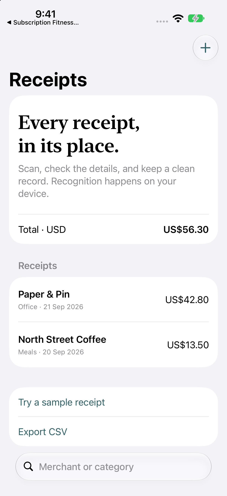

# Receipt Scanner

Turn receipt photos into editable expense records using on-device text recognition.

**iOS 15+ · iPhone and iPad · Swift · MIT License**

## What it does

- Scan with VisionKit or import a photo with the system photo picker.
- Extract suggested merchant, date, currency, and total with Vision OCR and a small parser.
- Review every field before saving, search records, and keep totals separate by currency.
- Export quoted CSV with formula-prefix protection or a PDF with the original receipt image.

## Run

Open `Receipt Scanner.xcodeproj` in Xcode 16 or later. The shared scheme has the same name. No third-party Swift packages are required. Builds were checked with Xcode 27; minimum OS declarations are not a claim that every older OS was runtime-tested.

Select an iPhone or iPad simulator and run. Manual entry works without camera access. The sample image exercises Vision OCR without requiring a camera. Use a supported physical device to check document-camera scanning.

Photos are selected through the system picker; the app does not request full photo-library access. No backend or API key is required.

Bundle identifier: `com.dd.receiptscanner`.

## Try it

Try a sample receipt, review the extracted fields, save it, then export CSV. Add a receipt in another currency and confirm totals remain separate.

## Implementation

`ReceiptParser` and `ReceiptCSV` are independently tested Foundation code. `ReceiptStore` normalizes image orientation, performs Vision work off the main actor, and persists reviewed records. Camera/photo picker wrappers and PDF rendering stay in the platform layer.

## Verification

Run `swift test` for total extraction, European number formatting, missing totals, CSV quoting, and spreadsheet formula-prefix protection. Camera behavior requires a physical device. The local Vision runtime check failed with an Apple ML backend error on the development machine; end-to-end OCR still needs verification on a supported device.

## Scope and limitations

OCR fields are suggestions and require review. Date parsing supports a few explicit formats; ambiguous dates and currencies need correction. Up to five scanned pages are recognized together, but only the first image is retained. There is no bank connection, currency conversion, or automatic accounting classification.

## Data and privacy

See [PRIVACY.md](PRIVACY.md) for storage and network behavior. Sample data is fictional.

## License

[MIT](LICENSE). Original source and app artwork are included under the same license.
